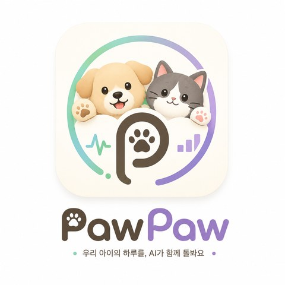

<div align="center">



# 🐾 Paw:Paw

### 반려동물의 건강 데이터를 기록하고, AI 챗봇과 함께 관리하는 펫 헬스케어 웹 서비스

[](https://reactjs.org/)
[](https://tailwindcss.com/)
[](https://fastapi.tiangolo.com/)
[](https://mongodb.com/)
[](https://vercel.com/)
[](https://render.com/)

</div>

---

## 📌 Overview

반려동물의 체중·복약·예방접종 기록을 한 곳에서 관리하고, AI 챗봇에게 증상을 상담하면
자동으로 대시보드에 기록이 쌓이는 반려동물 건강관리 웹 서비스입니다.

이 프로젝트는 **포트폴리오/시연 목적**으로 제작되었으며, 실사용 서비스를 목표로 하지 않습니다.
(AI 챗봇 API가 학교 제공 월간 할당량 안에서 동작하도록 설계되었습니다.)

> 팀 **404 Thinking**의 사이드 프로젝트

## ✨ Key Features

- 🏠 **대시보드** — 반려동물 캐릭터와 함께 체중·복약·예방접종 현황을 한눈에
- 🤖 **AI 챗봇 (자유 상담)** — 증상을 물어보면 완곡한 어조로 답변하고, 특이사항은 자동으로 대시보드에 기록 (병명 확진 없음)
- 💊 **AI 챗봇 (정보 등록)** — 복약(복용 기간 포함)·예방접종 정보를 대화 중 자연스럽게 언급하면 버튼 기반 슬롯필링으로 정확하게 등록
- 📊 **건강 리포트** — 월간 체중 변화, 증상 빈도, AI 진단 소견을 종합한 리포트
- 🐶 **마이펫이지** — 여러 반려동물을 한 계정에서 전환하며 관리
- 🔔 **인앱 알림** — 복약 시간 알림, 예방접종 D-Day 리마인드 (1주전·1일전·당일)를 벨 아이콘으로 확인

## 🧠 설계 포인트

학교 제공 AI API의 월간 토큰 할당량 안에서 동작해야 했기 때문에, "AI를 어디에 쓰고 어디에 안 쓸지"를 설계 단계에서부터 명확히 나눴습니다.

- **AI 호출 최소화** — 복약/예방접종 등록 트리거 감지, 슬롯필링처럼 결정론적으로 처리 가능한 로직은 키워드·정규식으로 직접 구현하고, LLM은 자유 상담 답변 생성에만 사용합니다. 답변 생성 한 번으로 증상 감지·요약까지 같이 받아 API 호출 자체를 쪼개지 않습니다.
- **3중 캐싱** — 같은 질문 반복 시 10분 TTL 캐시(MongoDB TTL 인덱스로 자동 만료), 월간 건강 리포트는 입력 컨텍스트 해시가 같으면 재생성하지 않음, 품종 가이드는 품종당 한 번만 생성해 전체 유저가 공유합니다.
- **병명 확진 방지 이중 장치** — 프롬프트 레벨에서 "사용자 노출용 답변"과 "대시보드 자동 저장용 요약"을 필드로 분리해 후자에는 병명을 금지하고, 서버가 저장 직전에 진단명 사전·접미사 규칙으로 요약을 한 번 더 걸러냅니다. 답변의 출처 태그도 정규식으로 재검증해 허용된 라벨 외에는 강제 치환합니다.
- **토큰 한도 관리와 시연 대비** — 월별 토큰 사용량을 누적해 한도 근접 시 호출 전에 차단하고, 사용자별 하루 상담 횟수를 제한합니다. `AI_MODE=mock|replay`로 개발기에는 목업, 발표 날에는 기록해둔 실제 응답을 토큰 소모 없이 재생합니다.
- **체중 그래프 보간** — 특정 날짜에 입력이 없으면 직전 값을 이어서 그래프가 끊기지 않게 처리합니다.

## 🛠 Tech Stack

| 분류 | 기술 |
|------|------|
| Frontend | React.js (Vite), Tailwind CSS v4 |
| Backend | FastAPI (Python) |
| Database | MongoDB Atlas (motor 비동기 드라이버) |
| 인증 | Kakao 소셜 로그인 + JWT 세션 |
| AI | 학교 제공 HAI-GPT (ChatGPT 계열 API) |
| 알림 | 인앱 알림 (벨 아이콘, 복약·예방접종 전용) — 카카오톡 알림톡은 발신 대행사 계약이 필요해 범위 밖 |
| 배포 | Vercel (Frontend), Render (Backend) |

## 🖥 Getting Started

### 요구사항
- Node.js 18+
- Python 3.11+
- MongoDB Atlas 계정
- Kakao Developers 앱 (REST API 키, Redirect URI 등록)
- HAI-GPT API 키 (학교 발급)

### Frontend
```bash
cd client
npm install
npm run dev
```

### Backend
```bash
cd server
python -m venv venv
source venv/bin/activate  # Windows: venv\Scripts\activate
pip install -r requirements.txt
uvicorn main:app --reload

# 테스트 (DB/AI 접속 없이 순수 로직만 검증)
pip install -r requirements-dev.txt
python -m pytest
```

### 환경변수
```bash
# server/.env (전체 목록은 server/.env.example 참고)
PORT=8000
MONGO_URI=
OPENAI_API_KEY=
OPENAI_BASE_URL=
OPENAI_MODEL=
JWT_SECRET=
KAKAO_CLIENT_ID=
KAKAO_CLIENT_SECRET=
KAKAO_REDIRECT_URI=http://localhost:5173/login/kakao/callback
FRONTEND_ORIGIN=  # 배포 시에만: 배포된 프론트엔드 origin (CORS 허용용)
AI_MODE=live                 # live / mock(개발기) / replay(시연)
AI_MONTHLY_TOKEN_LIMIT=0     # 월간 토큰 한도, 0이면 기록만
CHAT_DAILY_LIMIT_PER_USER=20 # 사용자당 하루 AI 상담 횟수, 0이면 무제한

# client/.env
VITE_API_URL=http://localhost:8000
VITE_KAKAO_JS_KEY=
```

## 🚀 Deployment

- **Frontend (Vercel)**: Root Directory를 `client`로 설정. `client/vercel.json`이 SPA 라우팅(새로고침 시 404 방지)을 처리한다. 환경변수는 위 client `.env` 항목 그대로 Vercel 프로젝트 설정에 등록.
- **Backend (Render, Free 인스턴스)**: New → Web Service로 저장소를 연결하고 아래처럼 설정한다.
  - Root Directory `server` / Branch `main`
  - Build Command `pip install -r requirements.txt`
  - Start Command `uvicorn main:app --host 0.0.0.0 --port $PORT` (Render는 `Procfile`을 읽지 않는다)
  - Health Check Path `/health`
  - 환경변수: 위 server `.env` 항목 전부 + `PYTHON_VERSION=3.12.3` (지정하지 않으면 Render 기본 버전으로 빌드되어 의존성이 검증되지 않은 버전에서 돈다). `FRONTEND_ORIGIN`은 배포된 Vercel 도메인으로 채워야 CORS가 통과한다.
  - MongoDB Atlas Network Access에서 Render 접속을 허용해야 한다 (Free 인스턴스는 고정 IP가 없어 `0.0.0.0/0`).
  - Free 인스턴스는 15분간 요청이 없으면 잠들고 다음 요청에서 깨어나는 데 약 1분이 걸린다 — 시연 전에 사이트를 한 번 열어 서버를 깨워둘 것.
  - 백엔드 주소가 바뀌면 Vercel의 `VITE_API_URL`을 갱신하고 **재배포**해야 반영된다 (빌드 시점 변수).
- **Kakao Developers 콘솔**: 배포된 프론트엔드 도메인의 `/login/kakao/callback`을 Redirect URI로 추가 등록해야 카카오 로그인이 동작한다.

## ⚠️ Known Limitations

- **백엔드 콜드 스타트** — 무료 호스팅(Render Free)이라 15분 이상 요청이 없으면 첫 접속에 약 1분이 걸립니다.
- **JWT를 `localStorage`에 저장** — 구현이 단순한 대신 XSS에 노출되면 토큰이 탈취될 수 있습니다. 실서비스라면 `HttpOnly` + `Secure` 쿠키와 CSRF 토큰 조합으로 바꿔야 합니다. 이 프로젝트는 포트폴리오/시연용이라 현재 방식을 유지합니다.
- **알림은 인앱(벨 아이콘)만 지원** — 카카오 알림톡은 비즈니스 채널과 유료 발신 대행사 계약이 필요해 범위에서 제외했습니다.

## 📁 Project Structure

```
paw-paw/
├── CLAUDE.md                # 프로젝트 공통 개발 규칙
├── client/                  # React 프론트엔드
│   ├── src/
│   │   ├── api/
│   │   ├── components/
│   │   ├── pages/
│   │   └── assets/
│   └── CLAUDE.md
├── server/                  # FastAPI 백엔드
│   ├── app/
│   │   ├── api/routes/      # auth, pets(대시보드 포함), users, chat, report, notification
│   │   ├── models/
│   │   ├── services/        # HAI-GPT 연동, 카카오 OAuth, 프롬프트
│   │   └── core/
│   ├── scripts/             # DB 마이그레이션/백필 스크립트
│   └── CLAUDE.md
└── docs/
    ├── SPEC.md               # 통합 기획 스펙
    ├── DESIGN.md             # 디자인 토큰 / UI 방향
    └── features/             # 기능별 상세 스펙
```

## 👥 Team 404 Thinking

| 이름 | 역할 |
|------|------|
| 정재훈 | 팀장 / 기획 / 디자인 |
| 이지원 | 기획 / 디자인 |
| 조한별 | 프론트엔드 |
| 김학래 | 백엔드 |

## 📄 License

MIT License © 2026 404 Thinking
